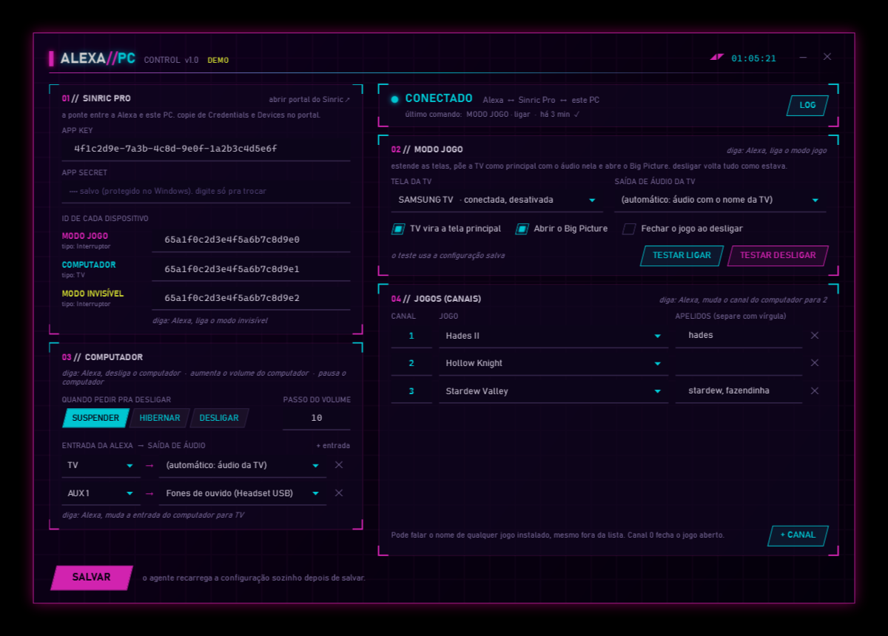

# Alexa PC Control

**Controle o PC e a Steam pela Alexa.**

"Alexa, liga o modo jogo": o PC estende a imagem pra TV da sala, a TV vira a tela principal, o som vai pra TV e o Big Picture abre lá. "Alexa, desliga o modo jogo" e tudo volta como estava. Dá também pra abrir jogo pelo nome, mexer no volume, pausar, trocar a saída de som, ficar invisível na Steam e suspender o PC, tudo por voz.

## Instalar (1 linha)

Abra o **PowerShell** (tecla Windows, digite `powershell`, Enter), cole a linha abaixo e aperte Enter:

```powershell
iwr https://github.com/IvanPJ/alexa-pc-control/archive/refs/heads/main.zip -OutFile $env:TEMP\apc.zip; Expand-Archive $env:TEMP\apc.zip $env:TEMP\apc -Force; & "$env:TEMP\apc\alexa-pc-control-main\Instalar.bat"
```

Pronto. A janela de configuração abre sozinha no final.

<details>
<summary>Prefere sem comando? Instale pelo ZIP</summary>

1. [Baixe o ZIP](https://github.com/IvanPJ/alexa-pc-control/archive/refs/heads/main.zip) e extraia em qualquer pasta.
2. Dê duplo clique em **`Instalar.bat`**.
3. Se aparecer a tela azul "O Windows protegeu o computador", clique em **Mais informações** e depois em **Executar assim mesmo**. Isso aparece porque o arquivo veio da internet.

</details>

Funciona no Windows 10 e 11. Não precisa de administrador nem de nenhum programa além da Steam.



## Configurar o Sinric Pro (uma vez, ~5 minutos)

A Alexa não fala direto com o seu PC. Quem faz a ponte é o [Sinric Pro](https://sinric.pro), um serviço que já tem skill oficial na Alexa. O plano grátis cobre **3 dispositivos**, exatamente o que este projeto usa. Se quiser mais, cada dispositivo extra custa US$ 3 por ano.

1. Crie uma conta grátis em **[sinric.pro](https://sinric.pro)**.
2. No portal, abra **Credentials** e copie o **App Key** e o **App Secret**.
3. Em **Devices**, crie estes 3 dispositivos. O nome é o que você vai falar pra Alexa, então pode trocar:

   | Nome | Tipo (Device Type) | Pra quê |
   |---|---|---|
   | **Modo Jogo** | Switch | Liga/desliga o modo jogo |
   | **Computador** | TV | Desligar, volume, mídia, entrada de som, abrir jogo |
   | **Modo Invisível** | Switch | Invisível/online na Steam |

4. Copie o **Device ID** de cada um.
5. Abra a janela **Alexa PC Control** no Menu Iniciar, cole o App Key, o App Secret e os 3 IDs, escolha qual tela é a TV e clique em **SALVAR**. Em alguns segundos o status mostra **CONECTADO**.
6. No app **Alexa** do celular: **Mais > Skills e jogos**, procure **Sinric Pro**, ative, entre com a sua conta do Sinric e toque em **Descobrir dispositivos**.

Pronto, os 3 aparecem no app Alexa como dispositivos normais.

## O que falar

| Fale | O que acontece |
|---|---|
| "Alexa, liga o modo jogo" | Telas em estender, TV como tela principal, som na TV, Big Picture na TV |
| "Alexa, desliga o modo jogo" | Fecha o Big Picture e volta telas e som como estavam |
| "Alexa, desliga o computador" | Suspende o PC (ou hiberna/desliga, você escolhe na configuração) |
| "Alexa, aumenta o volume do computador" / "abaixa o volume do computador" | Volume do Windows sobe/desce um passo |
| "Alexa, coloca o volume do computador em 30" | Volume em 30% |
| "Alexa, silencia o computador" / "tira o computador do mudo" | Mudo / com som |
| "Alexa, pausa o computador" / "continua o computador" / "próxima no computador" | Teclas de mídia (música, vídeo) |
| "Alexa, muda a entrada do computador para TV" | Som sai pela TV (as entradas são configuráveis) |
| "Alexa, muda o canal do computador para Elden Ring" | Abre o jogo pela Steam. Qualquer jogo instalado, pelo nome |
| "Alexa, muda o canal do computador para 2" | Abre o jogo do canal 2 da sua lista |
| "Alexa, muda o canal do computador para zero" | Fecha o jogo aberto |
| "Alexa, liga o modo invisível" / "desliga o modo invisível" | Invisível / online na Steam |

A frase exata pode variar um pouco: a Alexa entende várias formas de dizer a mesma coisa. Se alguma não pegar, teste outra ou use uma **rotina**.

### Atalhos com rotinas da Alexa

No app Alexa, em **Mais > Rotinas**, dá pra criar frases do seu jeito:

- **"Alexa, hora do jogo"**: liga a TV (se ela for compatível com a Alexa), espera uns segundos e liga o **Modo Jogo**. O modo jogo espera a TV aparecer por até 30 segundos.
- **"Alexa, abre o Elden Ring"**: ação **Personalizado** com o texto `muda o canal do computador para Elden Ring`.
- **"Alexa, boa noite"**: desliga o **Modo Jogo** e depois desliga o **Computador**.

## Perguntas rápidas

**Precisa deixar alguma coisa aberta?**
Não. Um agente pequeno roda escondido e sobe sozinho quando você entra no Windows. A janela de configuração pode ficar fechada.

**Dá pra ligar o PC pela Alexa?**
Não. O agente roda no próprio PC: desligado ou suspenso, não tem quem escute. "Desliga o computador" funciona; "liga" só responde se o PC já estiver ligado.

**E depois de suspender?**
Quando o PC acorda, o agente percebe e reconecta sozinho em poucos segundos.

**A TV não aparece no modo jogo.**
Ela precisa estar ligada e na entrada HDMI do PC. Muita TV desligada some pro Windows. Ligue a TV antes, ou numa rotina antes do Modo Jogo, como no exemplo acima. O agente espera até 30 segundos.

**Uso o [Steam Status Scheduler](https://github.com/IvanPJ/steam-status-scheduler). Tem conflito?**
Durante uma janela de horário dele, o status é reaplicado a cada minuto. Então "Alexa, desliga o modo invisível" vale só até o próximo minuto. Fora das janelas, nada é forçado.

**É seguro?**
- A conexão é só de saída, do PC pro Sinric, como uma aba do navegador. Nenhuma porta é aberta no seu PC ou roteador.
- Cada comando vem assinado pelo Sinric com o seu App Secret (HMAC-SHA256). Comando sem assinatura válida é recusado.
- O App Secret fica criptografado com a proteção de dados do Windows (DPAPI): só o seu usuário, neste PC, consegue ler.
- Nenhum login, senha ou arquivo de conta da Steam é lido. Só a lista de jogos instalados (os manifestos da biblioteca).

**Meu antivírus reclamou.**
São só scripts PowerShell abertos, dá pra ler cada arquivo. Se mesmo assim bloquear, adicione a pasta `%LOCALAPPDATA%\AlexaPcControl` às exceções e instale de novo.

**Como atualizo?**
Rode a linha de instalação de novo. Sua configuração é mantida.

**Como desinstalo?**
Abra a pasta `%LOCALAPPDATA%\AlexaPcControl` (cole isso na barra do Explorer) e dê duplo clique em `Desinstalar.bat`. Se o modo jogo estiver ligado, ele desliga antes. Os dispositivos continuam no Sinric e no app Alexa: apague por lá se não for mais usar.

**Algo não funcionou.**
Veja o `agente.log` na pasta `%LOCALAPPDATA%\AlexaPcControl`: cada comando da Alexa e o que o agente fez fica registrado.

## Como funciona

```
Alexa → skill Sinric Pro → wss://ws.sinric.pro → agente no seu PC → Windows / Steam
```

O agente é um script PowerShell iniciado pelo Agendador de Tarefas do Windows quando você faz login, sem janela (`conhost --headless`). Ele mantém uma conexão WebSocket com o Sinric Pro e, a cada comando:

- **telas**: usa a API de configuração de vídeo do Windows (a mesma do Win+P) pra estender, escolher a tela principal, guardar o layout de antes e restaurar depois;
- **som**: troca a saída padrão e mexe no volume pelas APIs de áudio do Windows;
- **Steam**: chama a própria Steam com links `steam://` (`open/bigpicture`, `rungameid/<id>`, `friends/status/invisible`).

Tudo roda como o seu usuário, sem administrador e sem instalar nada além do que já vem no Windows.

| Arquivo | Pra quê |
|---|---|
| `Instalar.bat` / `install.ps1` | Copia pra `%LOCALAPPDATA%\AlexaPcControl`, registra o agente e cria o atalho |
| `Agente.ps1` | O agente: conexão com o Sinric Pro e os comandos |
| `Pc.ps1` | Telas, áudio, teclas de mídia e janelas (APIs do Windows) |
| `Steam.ps1` | Big Picture, jogos, status e a busca de jogo pelo nome |
| `Config.ps1` | Formato do `config.json` e o App Secret criptografado |
| `Configurar.ps1` / `Configurar.bat` | A janela de configuração |
| `config.json` | Sua configuração |
| `Desinstalar.bat` / `uninstall.ps1` | Remove tudo |

## Licença

MIT. Faça o que quiser.
